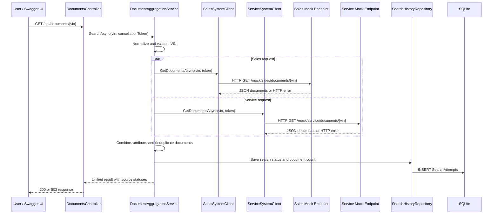

# Unified Document Viewer — System Design

## 1. Purpose and scope

The Unified Document Viewer provides one VIN-based search endpoint that aggregates vehicle documents from two dealership systems:

- Sales System: purchase invoices and sales agreements.
- Service System: inspection reports and maintenance records.

The implemented application is an ASP.NET Core Web API targeting .NET 10. The primary demo runs as one host and exposes a static end-user document viewer, the aggregation API, the deterministic mock APIs, Swagger UI, and search-history endpoints.

The application stores search attempts in SQLite. It does not store the documents returned by the mock systems.

## 2. Current architecture

The primary demo is a single ASP.NET Core process. The Sales and Service mock endpoints are embedded in the main API under separate route prefixes. The production clients still call those endpoints through `HttpClient`, preserving the external-client boundary without requiring three processes for the demo.

A separate `UnifiedDocumentViewer.MockSystems` project also exists. It can run the mock routes as separate HTTP processes for future integration or deployment testing, but it is not required for the normal single-host demo.

```mermaid
flowchart LR
User[User / Document Viewer or Swagger UI]
	Api[UnifiedDocumentViewer ASP.NET Core API]
	Controller[DocumentsController]
	Aggregator[DocumentAggregationService]
	SalesClient[SalesSystemClient<br/>Typed HttpClient]
	ServiceClient[ServiceSystemClient<br/>Typed HttpClient]
	SalesMock[Embedded Sales Mock<br/>/mock/sales]
	ServiceMock[Embedded Service Mock<br/>/mock/service]
	HistoryController[SearchHistoryController]
	HistoryRepo[SearchHistoryRepository]
	SQLite[(SQLite<br/>SearchAttempts)]

	User -->|GET /api/documents/{vin}| Api
	Api --> Controller
	Controller --> Aggregator
	Aggregator --> SalesClient
	Aggregator --> ServiceClient
	SalesClient -->|HTTP| SalesMock
	ServiceClient -->|HTTP| ServiceMock
	Aggregator -->|record outcome| HistoryRepo
	HistoryRepo --> SQLite
	User -->|GET /api/search-history| Api
	Api --> HistoryController
	HistoryController --> HistoryRepo
```

## 3. Component responsibilities

### API host and startup

`Program.cs` is responsible for:

- Registering MVC controllers.
- Registering Swagger and Swagger UI in Development.
- Serving the static end-user viewer from `wwwroot/index.html`.
- Registering EF Core SQLite and the application `DbContext`.
- Registering the aggregation service and history repository through dependency injection.
- Configuring typed `HttpClient` instances for Sales and Service.
- Applying the configured five-second external-system timeout.
- Creating the SQLite schema at startup with `EnsureCreatedAsync()`.
- Enabling console logging.

### `DocumentsController`

`DocumentsController` is intentionally thin. It:

- Accepts `GET /api/documents/{vin}`.
- Delegates validation and aggregation to `IDocumentAggregationService`.
- Converts validation exceptions to `400 Bad Request`.
- Returns `200 OK` for complete or partial success.
- Returns `503 Service Unavailable` when all sources fail.

### `DocumentAggregationService`

The aggregation service contains the business workflow. It:

- Normalizes and validates the VIN.
- Starts both source requests before awaiting either result.
- Uses `Task.WhenAll` to await the concurrent requests.
- Preserves caller cancellation.
- Maps every returned document to the source client’s source name.
- Removes duplicate documents.
- Builds per-source success and error status.
- Persists a `SearchAttempt` for the outcome.
- Logs external failures and persistence failures.

### Typed external clients

`SalesSystemClient` and `ServiceSystemClient` implement `IDocumentSourceClient`. Each uses an injected typed `HttpClient` and calls the configured relative path `documents/{vin}`.

The clients do not access the mock dictionaries directly. This preserves the same boundary that would be used for real external dealership systems.

### Embedded mock systems

`MockSystemsController` contains deterministic in-memory data for the Sales and Service systems. It supports:

- Known VIN datasets.
- `404 Not Found` for unknown VINs.
- `503 Service Unavailable` for failure VINs.
- `?fail=true` for explicit failure simulation.
- A basic health endpoint.

### Search history persistence

`SearchHistoryRepository` uses EF Core to write and read `SearchAttempt` records. It uses `AsNoTracking()` for history reads and returns the newest records first.

## 4. Request and data flow



The two tasks are created from the source-client collection before `Task.WhenAll` is awaited. Therefore, a slow Sales request does not prevent the Service request from starting.

## 5. API contracts

### 5.1 Aggregated document search

```http
GET /api/documents/{vin}
```

Example:

```http
GET /api/documents/VIN-SHARED-001
```

Successful response shape:

```json
{
  "vin": "VIN-SHARED-001",
  "documents": [
	{
	  "id": "SALE-001",
	  "vin": "VIN-SHARED-001",
	  "fileName": "purchase-invoice.pdf",
	  "documentType": "Purchase Invoice",
	  "documentDate": "2025-01-15T00:00:00",
	  "downloadUrl": "https://sales.example/documents/SALE-001",
	  "sourceSystem": "Sales"
	}
  ],
  "sources": {
	"Sales": {
	  "succeeded": true,
	  "error": null
	},
	"Service": {
	  "succeeded": true,
	  "error": null
	}
  },
  "retrievedAt": "2025-01-15T00:00:00Z",
  "hasSuccessfulSource": true
}
```

Status behavior:

| Status | Meaning |
|---|---|
| `200 OK` | Both sources succeeded, or at least one source succeeded. |
| `400 Bad Request` | The VIN is empty, shorter than three characters, longer than 17 characters, or contains characters other than letters, numbers, and hyphens. |
| `503 Service Unavailable` | All configured document sources failed. The response includes source status details. |

A valid VIN that returns no documents from either source is still a successful search and returns `200 OK` with an empty `documents` array.

### 5.2 Search history

```http
GET /api/search-history
GET /api/search-history?vin=VIN-FAIL-SALES
```

Response fields:

```json
[
  {
	"id": 1,
	"vin": "VIN-FAIL-SALES",
	"searchedAtUtc": "2025-01-15T12:00:00Z",
	"status": "PartialFailure",
	"documentsReturned": 1,
	"errorMessage": "Sales: The external system is unavailable."
  }
]
```

Records are ordered by `SearchedAtUtc` descending and then by ID descending.

### 5.3 Mock system endpoints

The embedded mock endpoints are also visible in Swagger:

```http
GET /mock/sales/documents/{vin}
GET /mock/service/documents/{vin}
GET /mock/health
```

Failure simulation:

```http
GET /mock/sales/documents/VIN-SHARED-001?fail=true
GET /mock/service/documents/VIN-SHARED-001?fail=true
```

The deterministic demo VINs include:

- `VIN-SHARED-001`: both systems return documents.
- `VIN-SALES-001`: Sales returns documents.
- `VIN-SERVICE-001`: Service returns documents.
- `VIN-FAIL-SALES`: Sales fails and Service succeeds.
- `VIN-FAIL-SERVICE`: Service fails and Sales succeeds.
- An unknown VIN: both systems return `404`, resulting in an aggregated `503`.

## 6. Document aggregation rules

### Source attribution

The source system is assigned by the client that returned the document. The aggregation service overwrites the document’s incoming `SourceSystem` value with the client source name. This prevents a malformed or incorrect external value from hiding the actual origin.

### Duplicate handling

Documents are deduplicated using a case-insensitive composite key:

```plaintext
SourceSystem + Document Id
```

This removes duplicate records from the same source while allowing two different systems to use the same document ID independently.

### Empty results

An empty response from a source is treated as a successful source call. If both sources return empty arrays, the search status is `Completed`, the document count is zero, and the API returns `200 OK`.

## 7. Failure and cancellation handling

### Partial failure

If one source throws an HTTP, timeout, or unexpected exception:

1. The exception is logged.
2. The failed source receives `succeeded: false` and an error message.
3. Documents from the successful source are retained.
4. The search is persisted with status `PartialFailure`.
5. The API returns `200 OK` because useful data is available.

### Total failure

If both sources fail:

1. Both failures are represented in the source-status dictionary.
2. No documents are returned.
3. The search is persisted with status `Failed`.
4. The controller returns `503 Service Unavailable`.

### Cancellation

The request cancellation token is passed to both external clients and the database repository. The service checks cancellation before validation, before source calls, and after `Task.WhenAll`. Caller cancellation is rethrown instead of being converted into an external-system failure.

An `OperationCanceledException` caused by an individual client timeout, when the caller token has not been cancelled, is treated as a source timeout and supports partial-result behavior.

## 8. Technology choices

| Technology | Use |
|---|---|
| .NET 10 | Application and test target framework. |
| ASP.NET Core Web API | HTTP API, controllers, dependency injection, configuration, and hosting. |
| C# async/await | Non-blocking external calls, database access, and request cancellation. |
| Typed `HttpClient` | Sales and Service external-client boundaries. |
| EF Core 10 SQLite | Persistent search-history storage. |
| Swashbuckle.AspNetCore 10.3.1 | Swagger document generation and Swagger UI. |
| xUnit | Unit-test framework. |
| Moq | Mocking source clients and history persistence in unit tests. |
| Console logging | Development logging provider. |

## 9. Database design

Only search attempts are persisted.

```mermaid
erDiagram
	SEARCH_ATTEMPT {
		long Id PK
		string Vin
		datetime SearchedAtUtc
		string Status
		int DocumentsReturned
		string ErrorMessage NULL
	}
```

EF Core configuration currently applies:

- Required `Vin`, maximum length 17.
- Required `Status`, maximum length 32.
- Optional `ErrorMessage`, maximum length 500.
- Index on `Vin`.
- Index on `SearchedAtUtc`.

The default database is:

```plaintext
UnifiedDocumentViewer/unified-documents.db
```

The application calls `EnsureCreatedAsync()` during startup. This is intentionally simple for the assessment. It creates the database and table when absent, but it is not a migration strategy for evolving production schemas.

## 10. Observability

### Implemented

The current implementation provides:

- Console logging through `AddConsole()`.
- ASP.NET Core request and hosting logs.
- EF Core SQL/database logs at the configured Information level.
- Warning logs for external timeouts and unavailable systems.
- Error logs for unexpected external exceptions.
- Error logs when search-history persistence fails.
- Source-specific status and error details in API responses.
- Persistent search history containing status, timestamp, document count, and error information.

The service logs structured values such as VIN and source system using logging message templates rather than only interpolated text.

### Not implemented: production additions

The following would be added for a production deployment:

- OpenTelemetry traces for inbound requests, each external HTTP call, and SQLite operations.
- Trace-context propagation to external dealership APIs.
- Metrics such as request count, latency, success/failure count per source, timeout count, document count, and database-write failures.
- A centralized log platform with structured JSON logs, correlation IDs, retention, and alerting.
- Dashboards and alerts for high source failure rates, increased latency, and database errors.
- Health checks that actively validate the database and external dependencies where appropriate.
- Redaction rules to ensure VINs and external URLs comply with privacy and security requirements.

## 11. Testing strategy

### Implemented unit tests

`UnifiedDocumentViewer.UnitTests` contains 11 xUnit tests for `DocumentAggregationService`:

- Both sources return documents.
- Both sources return empty results.
- Sales fails while Service succeeds.
- Both sources fail.
- Duplicate source/document IDs are removed case-insensitively.
- Four invalid VIN inputs are rejected and persisted as invalid attempts.
- Source attribution uses the client source name.
- Caller cancellation is propagated and does not persist a completed result.

The tests mock `IDocumentSourceClient` and `ISearchHistoryRepository`. They do not use live network calls, SQLite, or the mock endpoints.

### Verified commands

```powershell
dotnet build .\UnifiedDocumentViewer.slnx
dotnet test .\UnifiedDocumentViewer.slnx
```

The verified result for the current implementation was:

```plaintext
Build: passed with no warnings
Tests: 11 passed, 0 failed, 0 skipped
```

A Swagger smoke test also verified that `/swagger/v1/swagger.json` and `/api/search-history` return HTTP 200.

### Production test additions

A production-quality test suite would additionally include:

- ASP.NET Core integration tests for controller status mapping.
- Mock HTTP handlers or a test server for typed `HttpClient` behavior.
- SQLite integration tests covering schema initialization and persistence.
- A deterministic concurrency test proving both source requests begin before either is released.
- Contract tests against real Sales and Service API schemas.
- Resilience tests for timeout, malformed JSON, HTTP 4xx/5xx, and database failures.

## 12. Assumptions and trade-offs

- A VIN is accepted when it is 3–17 characters and contains only letters, numbers, or hyphens. This accommodates the deterministic demo VINs while applying basic input validation; it is not a full manufacturer-specific VIN verification algorithm.
- The source system plus document ID is the document identity rule.
- Valid searches with zero documents are successful searches.
- Search history is written after source aggregation completes. If the history write fails, the service logs and rethrows the persistence error rather than silently returning an unrecorded search.
- SQLite and in-memory mock data are appropriate for a local technical assessment.
- The embedded mock endpoints are used for the single-process demo so the viewer, APIs, and Swagger UI are available from one host.
- `EnsureCreatedAsync()` is acceptable for the initial schema, but migrations are required if the database schema becomes versioned.
- The custom viewer is intentionally a small static page with no frontend build dependency; it calls `GET /api/documents/{vin}` and renders the consolidated list and per-source status. Swagger remains available for API exploration.

## 13. AI assistance

AI assistance was used as a development aid for:

- Translating the scenario requirements into a practical layered architecture.
- Suggesting interfaces, dependency-injection registrations, typed clients, and failure-handling boundaries.
- Generating initial scaffolding and implementation drafts for the controllers, clients, aggregation service, EF Core persistence, mock endpoints, and unit tests.
- Reviewing code paths for cancellation, partial failures, source attribution, and duplicate handling.
- Drafting this design document from the implementation.

The implementation was verified in the repository through builds, unit tests, endpoint smoke tests, Swagger checks, SQLite persistence checks, and package vulnerability checks. AI suggestions were treated as drafts; the resulting behavior was accepted only after source review and execution-based verification.
